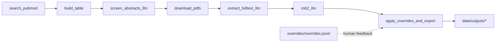

# Agent-assisted systematic review (microbiome × metabolic disease)

Reproducible pipeline to identify and evaluate **human randomized, placebo-controlled clinical trials (2014–2024)** of **live microbiome interventions** in metabolic disease (T2D/prediabetes, obesity/overweight, MASLD/NAFLD, NASH).

This repo implements “skills” as **standalone CLI scripts** that are **idempotent**, **schema-validated**, and **auditable**:
- Every step writes a `run_manifest.json`.
- LLM steps store per-record `request.json`, `response.json`, `parsed.json` and validate against JSON Schemas.
- Outputs are stable, column-ordered `csv` + `parquet` tables under `data/outputs/`.



## Quickstart

1) Create an environment and install:

```bash
make setup
```

2) Configure env vars (at minimum OpenAI for LLM steps):

```bash
cp .env.example .env
```

3) Run the pipeline:

```bash
make search
make table
make pdfs
make screen_abstracts
make extract
make rob2
make export
# or:
make all
```

## Pipeline steps (“skills”)

- `scripts/00_search_pubmed.py`: PubMed search + metadata/abstract fetch → `data/raw/*`.
- `scripts/01_build_table.py`: hint prefill + master screening table → `data/outputs/screening_table.*`.
- `scripts/02_download_pdfs.py`: best-effort PDF retrieval + text extraction → `data/raw/pdfs/*` and `data/intermediate/fulltext_text/*`.
- `scripts/03_screen_abstracts_llm.py`: LLM abstract screening (structured outputs) → updates table + artifacts.
- `scripts/04_extract_fulltext_llm.py`: LLM full-text extraction (structured outputs) → updates table + artifacts.
- `scripts/05_rob2_llm.py`: LLM RoB2 judgments (structured outputs) → updates table + artifacts.
- `scripts/06_apply_overrides_and_export.py`: deterministic tiering + overrides + exports + PRISMA counts.

## Outputs

- `data/outputs/screening_table.parquet` and `.csv`
- `data/outputs/final_table.parquet` and `.csv`
- `data/outputs/prisma_counts.json`
- LLM artifacts under `data/intermediate/llm/*/{record_id}/`

## Documentation

See:
- `docs/protocol.md`
- `docs/decision_rules.md`
- `docs/rob2_guidance.md`
- `docs/endpoint_taxonomy.md`
- `docs/data_dictionary.md`
