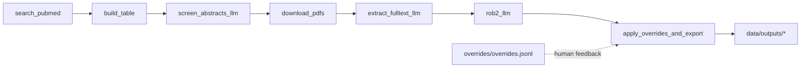

# Agent-assisted systematic review (microbiome × metabolic disease)

Agent-assisted operation with strong evidence guardrails is the supported execution model; unattended orchestration is not required. Use the repository-local [review skill](skills/agent-assisted-review/SKILL.md) and [finite release contract](docs/agent_assisted_release.md).

Latest: [local agent-assisted development release v0.1 assessment](docs/agent_assisted_release_v0.1_results.md) passes the finite two-case contract. HCQ mortality and the complete four-trial inhaled escalation analysis have audited primary inputs and source-verified reference discrepancies; neither is exact-input reproduction or whole-review/prospective validation. The inhaled result is RR0.702[0.537,0.918], with four checked RoB drafts.462 tests pass. [Current checkpoint](docs/autoresearch_status.md).

Reproducible pipeline to identify and evaluate **human randomized, placebo-controlled clinical trials (2014–2024)** of **live microbiome interventions** in metabolic disease (T2D/prediabetes, obesity/overweight, MASLD/NAFLD, NASH).

This repo implements “skills” as **standalone CLI scripts** that are **idempotent**, **schema-validated**, and **auditable**:
- Every step writes a `run_manifest.json`.
- LLM steps store per-record `request.json`, `response.json`, `parsed.json` and validate against JSON Schemas.
- Outputs are stable, column-ordered `csv` + `parquet` tables under `data/outputs/`.



## Quickstart

1) Create an environment and install:

```bash
make setup
```

2) Configure env vars (at minimum OpenAI for LLM steps):

```bash
cp .env.example .env
```

3) Run the pipeline:

```bash
make search
make table
make pdfs
make screen_abstracts
make extract
make rob2
make export
# or:
make all
```

## Pipeline steps (“skills”)

- `scripts/00_search_pubmed.py`: PubMed search + metadata/abstract fetch → `data/raw/*`.
- `scripts/01_build_table.py`: hint prefill + master screening table → `data/outputs/screening_table.*`.
- `scripts/02_download_pdfs.py`: best-effort PDF retrieval + text extraction → `data/raw/pdfs/*` and `data/intermediate/fulltext_text/*`.
- `scripts/03_screen_abstracts_llm.py`: LLM abstract screening (structured outputs) → updates table + artifacts.
- `scripts/04_extract_fulltext_llm.py`: LLM full-text extraction (structured outputs) → updates table + artifacts.
- `scripts/05_rob2_llm.py`: LLM RoB2 judgments (structured outputs) → updates table + artifacts.
- `scripts/06_apply_overrides_and_export.py`: deterministic tiering + overrides + exports + PRISMA counts.

## Outputs

- `data/outputs/screening_table.parquet` and `.csv`
- `data/outputs/final_table.parquet` and `.csv`
- `data/outputs/prisma_counts.json`
- LLM artifacts under `data/intermediate/llm/*/{record_id}/`

## Documentation

See:
- `docs/protocol.md`
- `docs/decision_rules.md`
- `docs/rob2_guidance.md`
- `docs/endpoint_taxonomy.md`
- `docs/data_dictionary.md`

## Autonomous quantitative reviews and historical benchmarks

A separate end-to-end runner searches Europe PMC's MED subset, screens abstracts,
retrieves accessible primary full texts, extracts numeric outcomes, checks quoted
evidence and independently verifies extraction, then pools supported independent
parallel-group comparisons. It preserves the original review workflow above.

```bash
# Uses an existing Codex login; no API key is needed for this backend.
.venv/bin/python -m scripts.autonomous_review run --protocol benchmarks/protocols/ma2013.yaml
.venv/bin/python -m scripts.autonomous_review run --protocol benchmarks/protocols/li2016.yaml
# An API key plus explicit --model are required for --backend openai.
# Compare only AFTER execution, using the printed run directory:
.venv/bin/python -m scripts.autonomous_review compare --run RUN_DIRECTORY --reference benchmarks/references/ma2013.json
```

Run artifacts live in `data/benchmarks/runs/`. Exit code 2 means incomplete or
blocked; inspect `status.json`, `report.md`, source files, extraction validation
errors and raw model events. Resuming reuses content-addressed validated model
results. `--limit N` is a pilot, never a completed benchmark. Frozen reference
answers are only read by `compare`, not supplied to extraction models.

Supported estimands are prespecified endpoint or change MD and Hedges SMD from
reported arm means, SDs, and analyzed sample sizes; fixed inverse variance and
DerSimonian–Laird random effects use normal confidence intervals. The optional
`continuous_derivations_v1` extension permits audited within-arm mean SE-to-SD
conversion and separately specified endpoint/change MD combination. Endpoint and
change SMDs cannot be combined. Missing dispersions, unresolved units/designs,
and repeated trial IDs are not silently pooled. This implementation does not
currently provide complete multi-database searching, automatic acquisition of
paywalled reports, comprehensive trial-family linkage, certainty-of-evidence
grading, or independently validated autonomous risk-of-bias judgments. Existing
RoB2 scripts remain available in the original workflow.

See [current execution status](docs/autonomous_review_status.md). Unit tests and
partial pooled results are not evidence of independently reproducing a review.

The original PDF downloader now uses the current public PMC Cloud dataset;
the former PMC OA/FTP endpoint was retired in August 2026. Image-only JATS tables
are supplemented with licensed PDF text where available. See the
[benchmark design](docs/autonomous_benchmark_design.md) for detailed safeguards.

The explicitly **secondary-source** numerical engine check can be rerun with:

```bash
.venv/bin/python -m scripts.benchmark_replay --forest benchmarks/references/li2016_fbg_forest.json --output data/benchmarks/li2016.secondary_replay.json
```

This recomputes a published forest plot and must not be reported as independent
trial extraction or autonomous review reproduction.

Development evaluation results (2026-10-12): [two real benchmark runs and their limitations](docs/autonomous_benchmark_results.md). Neither historical review was reproduced; the report distinguishes partial primary-source results from secondary-source arithmetic calibration.

The runtime now freezes its Python sources before execution, discovers public PDFs through bibliographic/DOI repositories and an isolated Codex web-search fallback, verifies source identity, segments oversized collections with provenance, and checks report-level participant dependence before pooling. Extraction calls remain tool-disabled. `ASR_WEB_DISCOVERY=0` disables the Codex-dependent URL-search fallback; metadata acquisition still runs. The default `--max-rounds 3` bounds automatic continuation of unfinished segmentation.

Finished runs also produce a human-readable audit and per-report CSV in `review_export/`. For an existing finished run, export with `python -m scripts.report_review --run <run-directory>`. An incomplete evidence set is clearly labeled, and unavailable sources are preserved as gaps rather than excluded as ineligible.

Infrastructure and evaluation details: [runtime specification](docs/runtime_v2_spec.md), [active execution status](docs/autonomous_review_status.md). The optional multiarm arithmetic extension is separately specified in `protocol/extensions/continuous_multiarm_v1.yaml` and remains disabled in the frozen benchmarks.

For a new review with multiple eligible parallel arms, explicitly prespecify
`multiarm_policy: combine_all_eligible_disjoint_arms_v1` in its protocol. The runner
then extracts all randomized arms, verifies original data and disjointness, and
combines eligible arms while retaining every original value. See
`protocol/extensions/continuous_multiarm_v1.yaml`; the two frozen benchmarks keep
their original rules. Interrupted bibliographic searches now retain completed pages
and resume from their saved cursor.

Source acquisition also supports verified scholarly HTML, direct checked PMC Cloud
PDF fallback, and bounded retrieval of supplements linked by the primary article.
Raw files, hashes and unsupported/unavailable attachments remain auditable. Numeric
verification receives the frozen protocol; publication-integrity flags and uncertain
participant overlap prevent unqualified pooling. These safeguards can produce an
incomplete report without user intervention; they cannot make unavailable evidence
or unsupported historical estimates reproducible.

Run both frozen benchmarks, draft outcome-specific risk-of-bias assessments, then
compare the finished reviews with their reference answers:

```bash
.venv/bin/python -m scripts.benchmark_suite --workdir data/benchmarks/new_suite --model gpt-6-astra --max-rounds 8
```

The suite verifies frozen protocol/reference hashes and writes `suite_report.md`
and `suite_report.json`. Reference answers are not sent to the review or RoB2
models. Each child review remains restartable. Use `--model` with an available
explicit model and a fresh work directory for a separately pinned evaluation;
resuming with a different protocol/backend/model is rejected to prevent relabeling
cached screening decisions.

The existing abbreviated project RoB2 template/schema now also work through the
authenticated backend. Drafts include exact-source checks and a separate model
verification, retain failures, and never alter pooled values or study weights.
They are not expert-validated RoB2 or GRADE assessments. To add this audit to a
finished numeric run:

```bash
.venv/bin/python -m scripts.rob2_draft --run path/to/finished/run
```

To preserve a finished run while preparing a new observation with the same
protocol and execution configuration, use `scripts.resume_inputs --source ...
--destination ...`. It copies complete raw bibliographic provenance and input
caches, excludes accepted/pooled/reference outputs, and refuses live sources or
nonempty destinations. Such warm development continuations are not held-out tests.

Latest completed evidence: [implemented source/statistical improvements and actual aligned benchmark results](docs/autonomous_reproduction_results_2026-10-13.md). The versioned Ma/Li development evaluations finished without reproduction: one valid Ma change effect and four valid Li reference contributors. Original failed benchmarks remain preserved in the [historical report](docs/autonomous_benchmark_final.md).

Current continuation: [accessible third-benchmark selection and prespecified method](docs/accessible_benchmark_selection_2026-10-13.md). The optional `luo_wan_quartiles_v1` method estimates endpoint mean/SD from explicit arm quartiles and analyzed n, retains the originals and assumptions, and exports a reported-statistics-only sensitivity. This extension never alters existing reported-SD-only protocols.

Latest execution: [source-audited subgroup recovery and remaining review uncertainty](docs/autonomous_development_results_2026-10-13.md). All three published IV subgroup effects and numerical target were recovered; the full benchmark stays incomplete for one additional candidate with an unconfirmed route. The broader failed case is preserved.

The autonomous research continuation is recorded in [docs/autoresearch_status.md](docs/autoresearch_status.md). The [artifact-audit cycle report](docs/autoresearch_artifact_audit_2026-10-13.md) includes a read-only CLI and actual old/new comparator counterexample.
